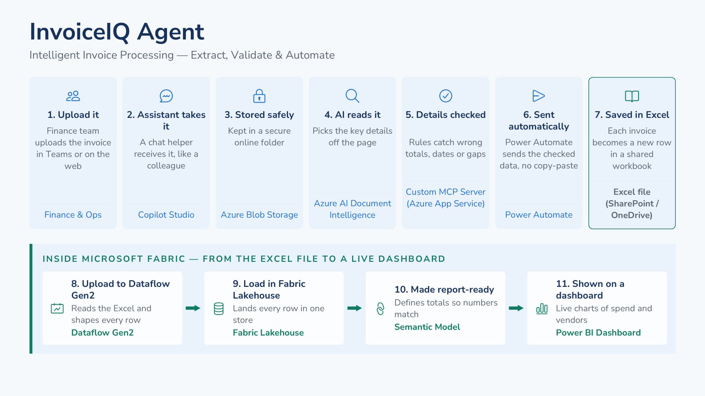

# InvoiceIQ — Automated Invoice Processing Agent · Solution Accelerator

Drop an invoice into Azure Blob Storage and an **autonomous Copilot Studio agent** extracts it with **Azure AI Document Intelligence** (through a custom **MCP server** on Azure App Service) and saves it as a row in **Excel**. **Microsoft Fabric** then loads the Excel data through **Dataflow Gen2** into a **Lakehouse**, models it in a **semantic model**, and shows it in a **Power BI** report.



## The flow

| # | Step | Service | In this repo |
|---|---|---|---|
| 1 | Invoice is uploaded | Azure Blob Storage — container `automated-invoice-processing-agent` | `infra/modules/storage.bicep`, `scripts/upload_sample.sh` |
| 2 | Agent wakes up | Copilot Studio trigger *When a blob is added or modified (properties only) (V2)* + SAS URL | `power-automate/README.md` (Flow 1) |
| 3 | AI reads it | **Invoice Extraction MCP** → `extract_invoice` → Document Intelligence `prebuilt-invoice` | `src/mcp-server/`, `infra/` |
| 4 | Saved to Excel | Agent flow **Save Automated Invoice Output** → table `InvoiceOutput` | `power-automate/README.md` (Flow 2), `excel/` |
| 5 | Load & shape | Fabric **Dataflow Gen2** | `fabric/dataflow-gen2-*.pq` |
| 6 | Store | Fabric **Lakehouse** (`invoices`, `dim_date`) | `fabric/README.md` |
| 7 | Model | **Semantic model** (Direct Lake) + DAX measures | `fabric/semantic-model-measures.dax` |
| 8 | Report | **Power BI** report *Invoice Insights* — Overview page built with Copilot | `fabric/powerbi-copilot-prompt.md` |

## Why InvoiceIQ
Finance and operations teams key invoices in by hand — vendor, invoice number, tax, currency, total — which is slow and error-prone at volume. InvoiceIQ makes the upload the only manual step: in the reference demo an invoice goes from Blob Storage to Excel in **about 14 seconds**, and Finance watches spend and extraction quality on a Power BI dashboard instead of a spreadsheet.

**Presales kit:** [Solution brief](docs/solution-brief.md) · [4-minute demo script](docs/demo-script.md) · [Word overview with screenshots](docs/InvoiceIQ_Solution_Demo_Overview.docx)

## Quick start
```bash
azd auth login
azd env new invoiceiq-dev
azd env set AZURE_LOCATION centralindia
azd env set MCP_API_KEY $(openssl rand -hex 32)
azd up
```
Then follow **[docs/deployment-guide.md](docs/deployment-guide.md)** — six phases, each ending with a check.

## Repository layout
```
├── azure.yaml                       azd: provision infra + deploy the MCP server
├── infra/                           Bicep (subscription scope)
│   ├── main.bicep, main.parameters.json
│   └── modules/  storage · docintel · appservice · keyvault · monitoring · rbac
├── src/mcp-server/                  Invoice Extraction MCP (Python, Streamable HTTP at /mcp)
│   ├── invoiceiq/  server.py · extractor.py · models.py · config.py
│   └── tests/
├── copilot-studio/                  agent instructions, setup guide, optional MCP custom connector
├── power-automate/                  Flow 1 (blob trigger + SAS) and Flow 2 (save to Excel)
├── excel/                           AutomatedInvoiceProcessingAgentOutput.xlsx (table InvoiceOutput)
├── fabric/                          Dataflow Gen2 M queries, DAX measures, Power BI Copilot prompt
├── sample-data/                     6 test invoices (INR, USD, GBP, CHF; supplies, cloud, consulting, design, healthcare GST, telecom)
├── scripts/                         deploy.sh · upload_sample.sh · test_mcp.py · build_assets.py
├── docs/                            solution brief, demo script, deployment guide, architecture, CI/CD, hardening, screenshots
└── .github/workflows/               ci.yml (tests + Bicep lint) · deploy.yml (OIDC)
```

## Excel output (what the agent writes)
| VendorName | InvoiceNumber | InvoiceDate | CustomerName | TotalTax | InvoiceTotal | Currency | ConfidenceScore | DocumentURL |
|---|---|---|---|---|---|---|---|---|
| Contoso Supplies Pvt Ltd | CS-2026-1042 | 2026-10-05 | Fabrikam Industries Ltd | 3690 | 24190 | INR | 0.98 | https://…/automated-invoice-processing-agent/01_Contoso….pdf |

Missing values are written as `NA`. The SAS token is removed from `DocumentURL`.

## Security defaults
Managed identity from the MCP app to Document Intelligence, Storage and Key Vault · Document Intelligence key auth disabled · MCP API key only in Key Vault · read-only 2-hour SAS per invoice, never stored · HTTPS/TLS 1.2. The storage account allows access keys by default because the reference build's Blob connector uses them; [docs/hardening.md](docs/hardening.md) shows the keyless setup and the rest of the production checklist.

## Docs
- [Solution brief](docs/solution-brief.md) — business case, components, benefits, engagement plan
- [Demo script](docs/demo-script.md) — run of show, talking points, recovery tips, Q&A
- [Step-by-step deployment guide](docs/deployment-guide.md)
- [Architecture & data contract](docs/architecture.md)
- [GitHub Actions setup](docs/github-actions-setup.md)
- [Production hardening](docs/hardening.md)

## License
MIT
