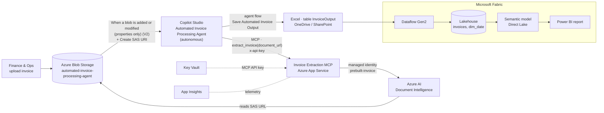
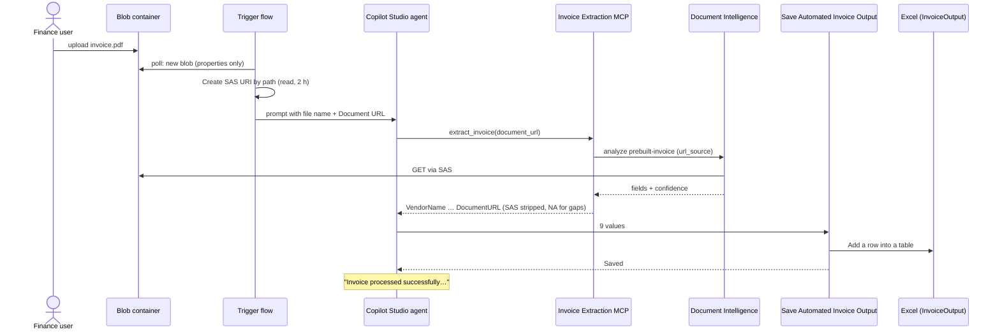

# Architecture

## One invoice, end to end

Downstream, on a schedule: **Dataflow Gen2** reads `InvoiceOutput` → cleans/types/de-duplicates → **Lakehouse** tables → **Direct Lake semantic model** → **Power BI**.

## Data contract (single source of truth)

`src/mcp-server/invoiceiq/models.py → OUTPUT_COLUMNS`

| Column | Source (prebuilt-invoice) | Notes |
|---|---|---|
| VendorName | `VendorName` | |
| InvoiceNumber | `InvoiceId` | |
| InvoiceDate | `InvoiceDate` | ISO `yyyy-MM-dd` |
| CustomerName | `CustomerName` | |
| TotalTax | `TotalTax` | number, `NA` if absent |
| InvoiceTotal | `InvoiceTotal` | number |
| Currency | currency code of the amount fields | symbol mapped to ISO code if needed |
| ConfidenceScore | document-level confidence | 0–1, 2 decimals |
| DocumentURL | the input URL | **SAS token removed** |

The same nine names are the agent-flow inputs and the Excel table columns; `scripts/build_assets.py` regenerates the Excel template from this list.

## Design choices

| Choice | Why |
|---|---|
| **Autonomous agent on a Blob trigger** | Matches how invoices actually arrive (dropped into storage by people, scanners or other systems); no one has to chat to the bot. |
| **MCP server with one tool** | Copilot Studio discovers the tool and its description automatically; the same server can be reused by Microsoft 365 Copilot, Azure AI Foundry agents or VS Code. |
| **Document Intelligence reads the SAS URL directly** | The MCP server never handles file bytes for the normal path → small, fast, stateless. Non-SAS URLs on the solution's own storage account are downloaded with the app's managed identity (keyless option). |
| **SAS stripped before Excel** | The workbook is shared; it must not hold working links to the files. |
| **Missing values → `NA` in the tool, `null` in Fabric** | Readable for Finance in Excel, correct for aggregation in the model. |
| **Cleaning in Dataflow Gen2, not in Excel** | The agent writes text; the dataflow makes types, currencies and duplicates consistent once, for every report. |
| **Currency-safe measures** | Totals only show for one currency at a time, so INR and USD are never summed together. |
| **Stateless Streamable HTTP + API key** | Scales out on App Service without sticky sessions; simplest auth the Copilot Studio MCP wizard supports. OAuth upgrade path in [hardening.md](hardening.md). |
