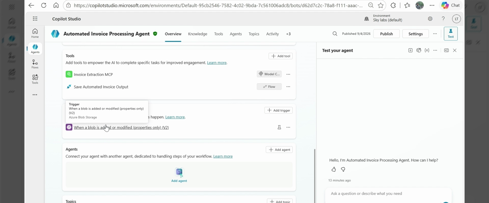
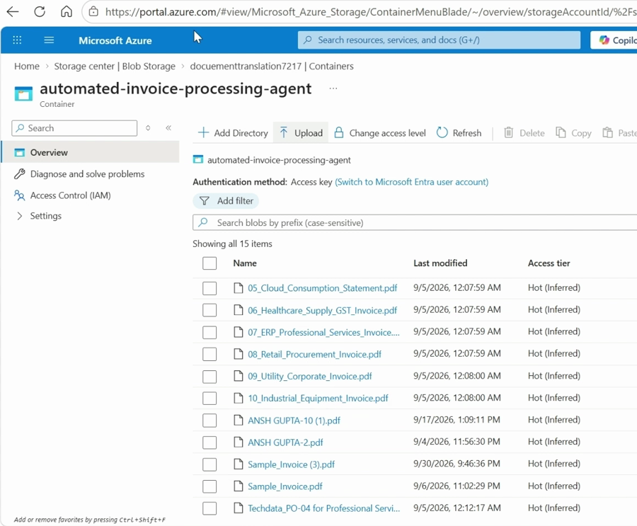
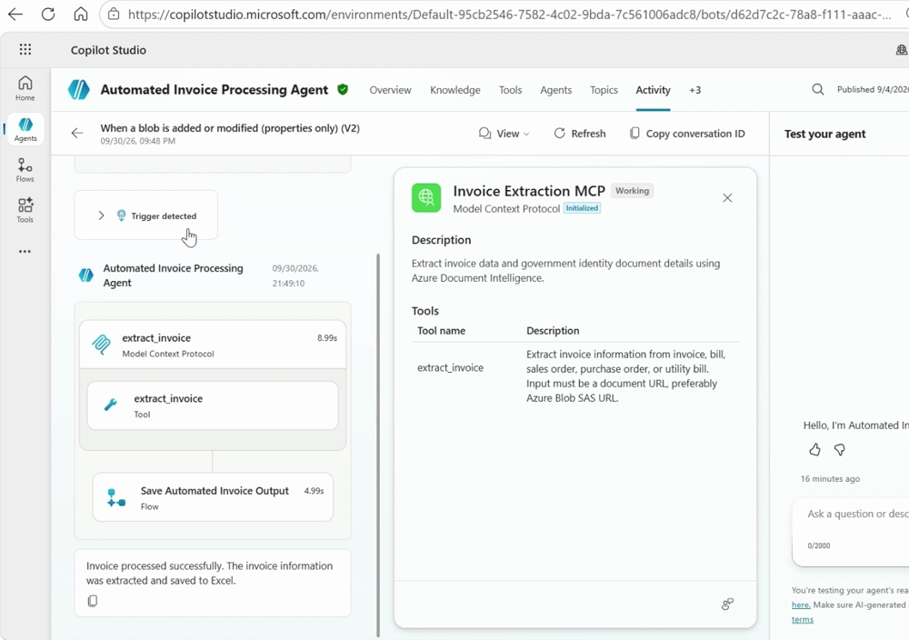

# Step-by-step deployment guide

**Overall flow**

```
Invoice file ─► Azure Blob container ─► Copilot Studio autonomous agent (blob trigger)
                                         ├─► Invoice Extraction MCP  (App Service ─► Document Intelligence)
                                         └─► Save Automated Invoice Output (agent flow ─► Excel)
Excel ─► Fabric Dataflow Gen2 ─► Fabric Lakehouse ─► Semantic model ─► Power BI report
```

Build it **back to front** — each phase ends with a check, so you never debug two layers at once.

| Phase | What you build | Time |
|---|---|---|
| 0 | Prerequisites | 30 min |
| 1 | Azure: Blob Storage, Document Intelligence, Invoice Extraction MCP server | 30 min |
| 2 | Excel workbook + *Save Automated Invoice Output* agent flow | 20 min |
| 3 | Copilot Studio agent: instructions, MCP tool, flow tool, Blob trigger | 40 min |
| 4 | End-to-end invoice test | 15 min |
| 5 | Fabric: Dataflow Gen2 → Lakehouse → Semantic model | 45 min |
| 6 | Power BI Overview page with Copilot + sharing | 15 min |

---

## Phase 0 — Prerequisites

| Need | Why |
|---|---|
| Azure subscription — **Owner** (or Contributor + User Access Administrator) | The template creates role assignments |
| Microsoft 365 with OneDrive/SharePoint and Excel for the web | Excel register |
| **Copilot Studio** licence/capacity in a Power Platform environment | The agent (autonomous agents consume Copilot Studio messages/credits) |
| Power Automate — the *Azure Blob Storage* connector is premium | Trigger + flows (runs are covered under Copilot Studio when called by the agent) |
| **Microsoft Fabric** capacity (F2+ or trial) | Dataflow Gen2, Lakehouse, semantic model |
| Power BI Pro/PPU for report viewers (unless capacity ≥ F64) | Report consumption |

Tools: `az` (2.60+), `azd` (optional, easiest), Python 3.12 (only for local testing), `jq`.

---

## Phase 1 — Azure (Blob Storage, Document Intelligence, MCP server)

### 1.1 Deploy — pick one

**A. Azure Developer CLI (recommended)**
```bash
git clone https://github.com/<your-org>/invoiceiq-agent-accelerator.git
cd invoiceiq-agent-accelerator
azd auth login
azd env new invoiceiq-dev
azd env set AZURE_LOCATION centralindia
azd env set MCP_API_KEY $(openssl rand -hex 32)
azd env set AZURE_PRINCIPAL_ID $(az ad signed-in-user show --query id -o tsv)
azd up
azd env get-values        # note STORAGE_ACCOUNT_NAME, MCP_SERVER_URL, MCP_API_KEY
```

**B. Azure CLI script** — `az login && ./scripts/deploy.sh invoiceiq-dev centralindia` (prints the outputs and the generated API key).

**C. GitHub Actions** — [github-actions-setup.md](github-actions-setup.md).

### 1.2 What gets created (`rg-<env>`)
| Resource | Purpose |
|---|---|
| Storage account + container **`automated-invoice-processing-agent`** | Invoice drop zone the agent watches. Private, TLS 1.2, versioning, 30-day soft delete |
| Azure AI **Document Intelligence** (S0) | `prebuilt-invoice` model. Key auth disabled — Entra ID only |
| **App Service** (Linux, Python 3.12) + managed identity | Invoice Extraction MCP server at `/mcp`, health at `/health` |
| **Key Vault** | `mcp-api-key` secret (App Service reads it via Key Vault reference) |
| Log Analytics + Application Insights | Logs, traces, failures |
| Role assignments for the app identity | Cognitive Services User · Storage Blob Data Reader · Key Vault Secrets User |

### 1.3 Check ✅
```bash
curl https://<MCP_APP_NAME>.azurewebsites.net/health
# {"status":"ok","service":"invoice-extraction-mcp"}

# Upload a sample and get a 1-hour SAS URL (uses your Entra login)
./scripts/upload_sample.sh <STORAGE_ACCOUNT_NAME> sample-data/01_Contoso_Office_Supplies_INR.pdf

pip install httpx
python scripts/test_mcp.py <MCP_SERVER_URL> <MCP_API_KEY> "<SAS URL from the previous command>"
```
Expected (values approximate):
```json
{ "status": "Success", "VendorName": "Contoso Supplies Pvt Ltd", "InvoiceNumber": "CS-2026-1042",
  "InvoiceDate": "2026-10-05", "CustomerName": "Fabrikam Industries Ltd", "TotalTax": 3690.0,
  "InvoiceTotal": 24190.0, "Currency": "INR", "ConfidenceScore": 0.98,
  "DocumentURL": "https://<account>.blob.core.windows.net/automated-invoice-processing-agent/01_Contoso_Office_Supplies_INR.pdf" }
```
The first call can take ~20 s while the app warms up.

---

## Phase 2 — Excel + *Save Automated Invoice Output*

1. Upload `excel/AutomatedInvoiceProcessingAgentOutput.xlsx` to OneDrive for Business or a SharePoint library. It has sheet **Invoice Output** and table **InvoiceOutput** with the nine columns the agent fills ([screenshot](images/ref-04-excel-output.png)).
2. Build the agent flow — [power-automate/README.md → Flow 2](../power-automate/README.md#flow-2--save-automated-invoice-output-agent-flow): *When an agent calls the flow* (9 text inputs) → *Add a row into a table* → *Respond to the agent*.

**Check ✅** — in the flow designer, **Test → Manually**, enter dummy values → a row appears in the workbook. Delete it afterwards.

---

## Phase 3 — Copilot Studio agent

Follow [copilot-studio/README.md](../copilot-studio/README.md):

1. Create **Automated Invoice Processing Agent**, paste [the instructions](../copilot-studio/agent-instructions.md), orchestration **Generative**, Web Search **off**, no knowledge.
2. **Tools → Add a tool → Model Context Protocol** → *Invoice Extraction MCP*, URL = `MCP_SERVER_URL`, API key header `x-api-key`. You should see the tool `extract_invoice`.
3. **Tools → Add a tool → Flow** → *Save Automated Invoice Output*.
4. **Triggers → Add trigger → When a blob is added or modified (properties only) (V2)** on container `automated-invoice-processing-agent`, then edit it in Power Automate to add **Create SAS URI by path (V2)** and pass the URL in the prompt — [power-automate/README.md → Flow 1](../power-automate/README.md#flow-1--blob-trigger-when-a-blob-is-added-or-modified-properties-only-v2).
5. **Publish.**

When done, the Overview page looks like this:



---

## Phase 4 — End-to-end invoice test

1. Upload the six samples (portal **Upload**, Storage Explorer, or the script):
   ```bash
   for f in sample-data/*.pdf; do ./scripts/upload_sample.sh <STORAGE_ACCOUNT_NAME> "$f" >/dev/null; done
   ```
   
2. Copilot Studio → **Activity**: one run per file — *Trigger detected* → `extract_invoice` → *Save Automated Invoice Output* → "Invoice processed successfully…".
   
3. Excel: six new rows — INR office supplies, USD cloud services (`TotalTax` = NA), GBP consulting, CHF design services, INR healthcare supplies (GST 12 %) and INR telecom bill (GST 18 %).
4. Then try a few real, non-confidential invoices from different vendors and layouts; check values against the PDFs.

**Check ✅** — every uploaded file has exactly one row; `DocumentURL` has no `?sv=…&sig=…` part.

---

## Phase 5 — Fabric: Dataflow Gen2 → Lakehouse → Semantic model

Follow [fabric/README.md](../fabric/README.md):

| Step | Item | Asset |
|---|---|---|
| 5.1 | Lakehouse `lh_invoiceiq` | — |
| 5.2 | Dataflow Gen2 `df_invoiceiq`: query `invoices` reads table `InvoiceOutput` from the Excel file and cleans it; query `dim_date` builds the calendar | `fabric/dataflow-gen2-invoices.pq`, `fabric/dataflow-gen2-dim-date.pq` |
| 5.3 | Data destination → Lakehouse tables `invoices`, `dim_date` (Replace); schedule refresh | — |
| 5.4 | Semantic model `sm_invoiceiq` (Direct Lake): relationship, date table, measures | `fabric/semantic-model-measures.dax` |

**Check ✅** — Lakehouse table `invoices` row count = non-empty, de-duplicated rows in Excel; in the model, `Invoice Count` matches.

---

## Phase 6 — Power BI report

Create **Invoice Insights** from `sm_invoiceiq` and build the **Overview** page with Copilot in Power BI using the prompt in [fabric/powerbi-copilot-prompt.md](../fabric/powerbi-copilot-prompt.md), then publish a workspace **App** to Finance & Ops.

**Check ✅** — upload a new invoice → agent writes the row → after the next dataflow refresh it appears in the report.

---

## Go-live checklist
- [ ] Empty template row in Excel is the only blank row; no test rows left
- [ ] Agent flow concurrency = 1, retries on
- [ ] Trigger condition limits to PDF/image files
- [ ] App Service SKU sized (P0v3+, 2 instances for production)
- [ ] App Insights alert on MCP 5xx; Copilot Studio Activity reviewed weekly
- [ ] Dataflow refresh schedule set; failure e-mail notifications on
- [ ] [hardening.md](hardening.md) reviewed (private endpoints, keyless storage, OAuth on MCP)
- [ ] Owners named for agent, flows, Azure resources, Fabric workspace

## Troubleshooting

| Symptom | Fix |
|---|---|
| Upload to blob but no agent run | Agent not **published**; trigger polls every 1 min (check *How often*); trigger condition excludes the file extension |
| Run fails at `extract_invoice` with 401 | Copilot Studio MCP connection key/header wrong — header must be `x-api-key` |
| `extract_invoice` → *Could not analyze the document … InvalidContent/URL* | SAS URL expired or missing **Read** permission; Document Intelligence can't reach the storage account (firewall) |
| `extract_invoice` → *must be an https URL on an allowed host* | The prompt didn't contain the SAS URL — check the *Sends a prompt…* body in the trigger flow |
| Everything `NA` | File isn't an invoice, or a poor scan; try 300 dpi PDF |
| Row not written to Excel | Flow 2 failed — open its run history; table name must be `InvoiceOutput` |
| Same invoice appears twice in Excel | File was re-uploaded (blob *modified* also fires). The dataflow keeps only the latest row per vendor + invoice number |
| Dataflow: *Excel table not found* | Wrong `FileName`/`SiteUrl`, or table renamed |
| Amount cards blank in the report | More than one currency selected — choose one in the Currency slicer (by design) |
| Re-deploy after deleting the RG fails on Key Vault | Purge protection keeps the name for 30 days — use a new environment name |

## Run the MCP server locally
```bash
cd src/mcp-server
python -m venv .venv && source .venv/bin/activate
pip install -r requirements-dev.txt && python -m pytest -q
cp .env.sample .env        # fill from `azd env get-values`
az login
set -a && source .env && set +a
python -m uvicorn invoiceiq.server:app --port 8000
python ../../scripts/test_mcp.py http://localhost:8000/mcp local-dev-key "<SAS URL>"
```
